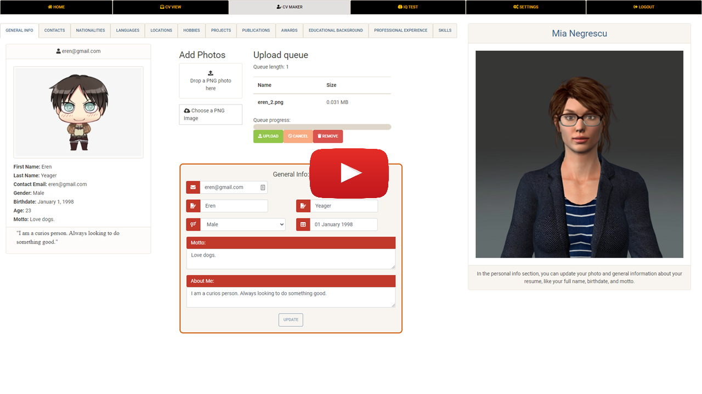
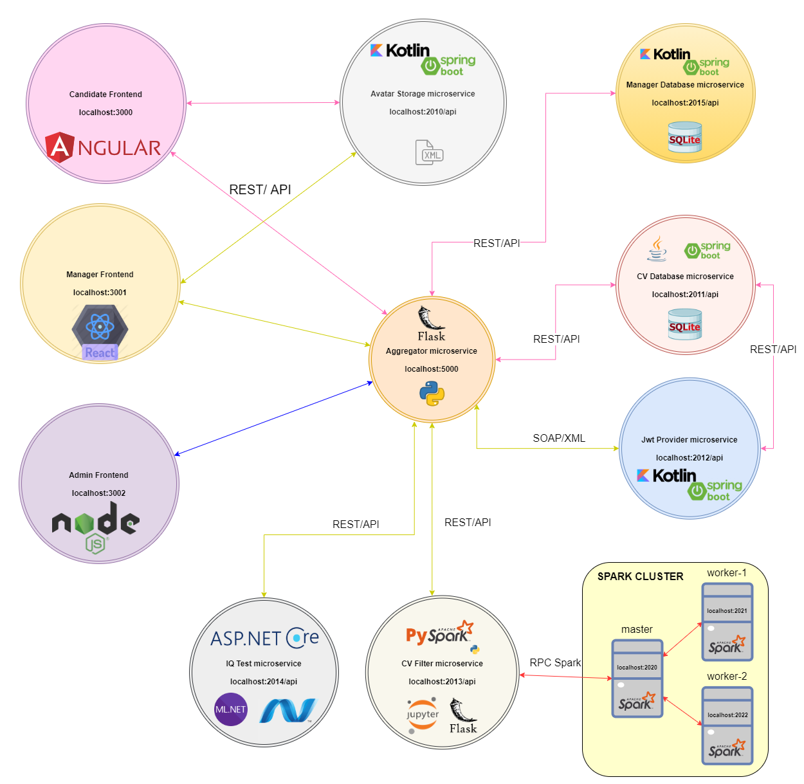
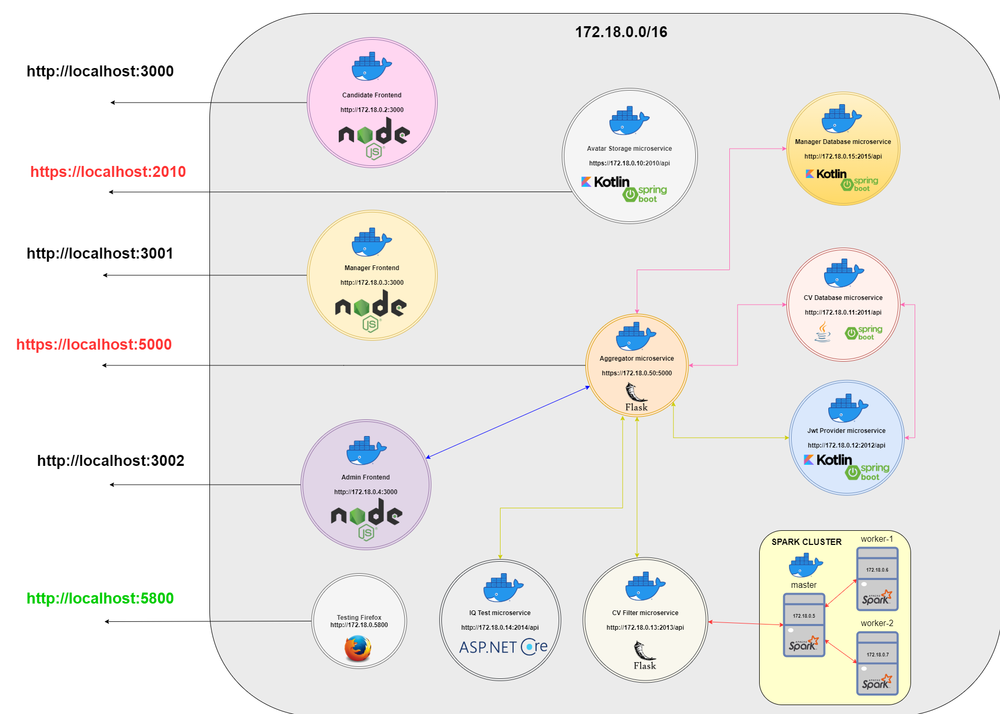
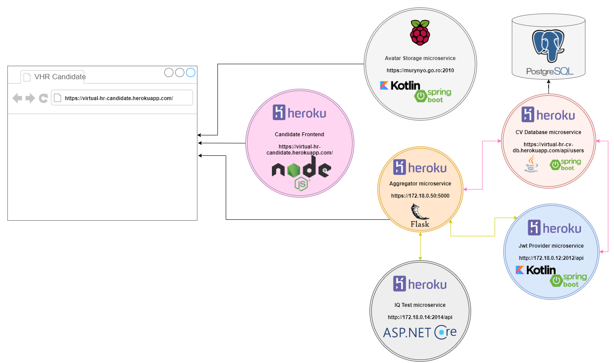
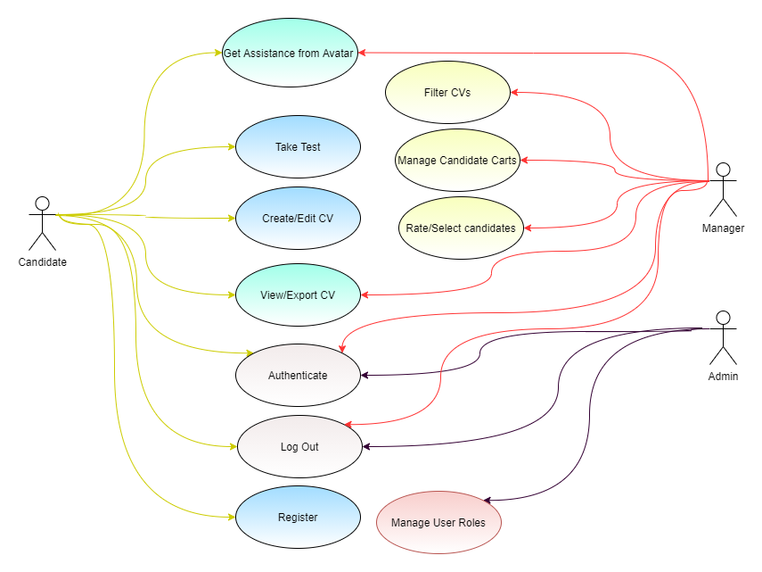
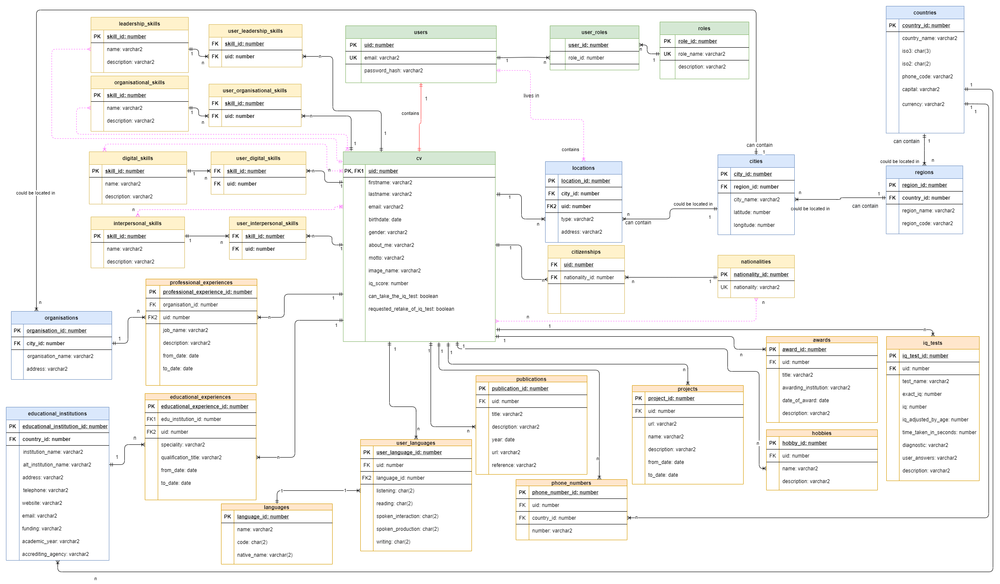

# Virtual HR Application

**Forked from** [enaki/LicenseProject](https://github.com/enaki/LicenseProject)  
*All sensitive credentials and configuration values have been stripped from this version.*

A **micro-service–driven** HR platform that lets companies interview candidates through
interactive avatars, evaluate IQ in real time, filter CVs automatically, and manage the entire hiring pipeline
from one place.

---

## 📑 Table of Contents
1. [Demo](#live-demo)  
2. [Architecture Overview](#architecture-overview)  
3. [Core Micro-services](#core-micro-services)  
4. [Docker](#docker)  
5. [Cloud Deployment](#cloud-deployment)  
6. [Challenges](#challenges)  
7. [Appendix](#appendix)  

---

## 📽️ Demo

Presentation Slides hosted [here](https://docs.google.com/presentation/d/17TEai_QNPFJXnogMWgI9hjDzIf2zb7EE/edit?usp=sharing&ouid=100319267693311271464&rtpof=true&sd=true).

## Architecture Overview

The backend is split into **10 independently deployable services** communicating via REST.
The **Aggregator** service exposes a public gateway, orchestrating calls to the remaining services.
An additional *JWT Provider* issues/validates tokens used by every request.

---

## Core Micro-services

| Service | Responsibility | Tech Stack (runtime / data) | Diagrams |
|---------|----------------|-----------------------------|----------|
| **Avatar Storage** | Stores XML-defined avatar questions, videos & branching logic | Spring Boot · Kotlin · XML | [Class Diagram](documentation/images/avatar_db/avatar_db-class_diagram.png) [File System](documentation/images/avatar_db/avatar_db-file_system.png) |
| **CV Database** | Persists candidate CVs & attachments | Spring Boot · Java · SQLite / PostgreSQL | [ER Diagram](documentation/images/cv_db/cv-db-er.png) [Class Diagram](documentation/images/cv_db/cv_db-class_diagram_3_layer_sequence.png) |
| **Manager Database** | Persists HR-manager related data | Spring Boot · Kotlin · SQLite / PostgreSQL | [ER Diagram](documentation/images/manager_db/manager-db-er.png) [Class Diagram](documentation/images/manager_db/manager_db-class_diagram.png) |
| **JWT Provider** | Issues & validates SHA-256–signed JWTs | Spring Boot · Kotlin · SOAP/XML | [Class Diagram](documentation/images/jwt_provider/jwt_provider-class-diagram.png) |
| **IQ Test** | Delivers Raven-style IQ questions, grades & scales by age | ASP.NET · C# | [Class Diagram](documentation/images/iq_test/iq_test-class_diagram.png) [Service Action](documentation/images/_service_composition/microservices-iq_test_action.png) |
| **CV Filter** | Applies rule-based checks (skills, experience, language) to CVs | Flask · Python3 · PySpark | [Pipeline](documentation/images/cv_filter/cv_filter-pipeline.png) [Service Action](documentation/images/_service_composition/microservices-filter_cvs_action.png) |
| **Aggregator** | Public gateway; orchestrates & aggregates data across all micro-services | Flask · Python3 · REST gateway | [Adapter Diagram](documentation/images/adapter/agregator.png) |
| **Candidate UI** | Angular SPA for applicants | Angular · TypeScript · Node.JS | [Observer Pattern](documentation/images/ui/ui-avatar-update.png) [General Screenshot](documentation/ss/candidat/candidat_general_info.png) [CV View Screenshot](documentation/ss/candidat/cv_view.png) [IQ Results Screenshot](documentation/ss/candidat/view_results.png) |
| **Manager UI** | React SPA for recruiters | React · TypeScript · Node.JS | [Filter Screenshot](documentation/ss/manager/manager_filter.png) [Cart Edit Screenshot](documentation/ss/manager/manager_cart_edit.jpg) |
| **Admin UI** | User Management for admins | Vanilla Javascript · Node.JS | [User Roles Screenshot](documentation/ss/admin/admin_user_roles.png) |

## Docker

The application was encapsulated in Docker, using docker-compose for some services.

## Cloud Deployment

The application was deployed in Heroku for testing with 100+ students in the first month. Due to Heroku dyno reset every day, SQLite could no be used, so a migration to a managed SQL server (e.g. PostgreSQL) was required.

Later on, the application was deployed for a week in each year, in AWS as a Docker demo for Distributed System laboratory.

## Challenges

1. Designing & maintaining 500 + XML avatar scenarios
2. Generating world-wide geo-seeds (≈ 190 countries, 45 k cities)
3. Building a neural-network for iq test with limited labelled data
4. Automating tests for 356 endpoints (including edge cases & auth)
5. Heroku 24H container reset, which erases locally stored data

## Appendix

### Use-Case Diagram

### CV Database ER Diagram

